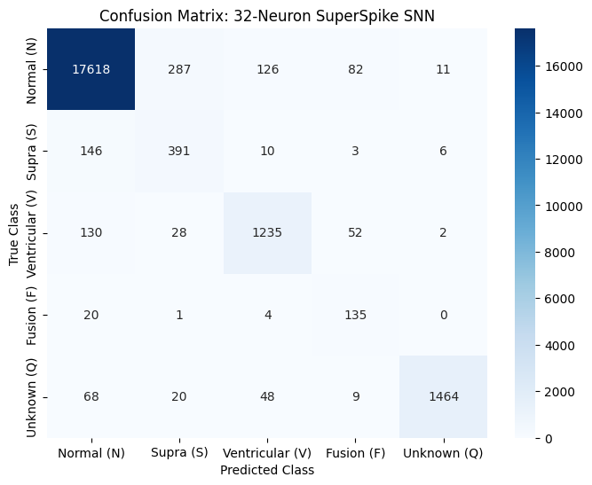

# Baseline Evaluation Report (SuperSpike + van Rossum SNN)

**Date:** October 8, 2026  
**Goal:** Secure the 60-epoch baseline model using SuperSpike and van Rossum distance for hardware deployment on the Spartan-7 FPGA.

## 1. Network Architecture
The network is a pure Spiking Neural Network (SNN) optimized for hardware constraints (0 DSP multipliers, binary spikes, bit-shift friendly leakage).
* **Input Layer:** 128 features (Quantized ECG window)
* **Hidden Layer 1:** 32 Leaky Integrate-and-Fire (LIF) neurons
* **Hidden Layer 2:** 32 LIF neurons
* **Output Layer:** 5 LIF neurons (AAMI classes: N, S, V, F, Q)
* **Time Steps:** 25
* **Membrane Decay ($\beta$):** 0.9375 (Hardware equivalent: `mem - (mem >> 4)`)

## 2. Training Methodology
* **Loss Function:** van Rossum Distance Loss ($\tau = 2.0$)
* **Data Augmentation:** Heavy (Gaussian noise, random cutouts, temporal scaling, beta-mixup) to balance the minority classes to 20,000 samples each.
* **Epochs:** 60
* **Scheduler:** Cosine Annealing LR

## 3. Evaluation Protocol & Split Disclosure
* **Dataset Split:** Stratified **Intra-Patient** Random Split (80% train / 20% test, $N_{\text{test}} = 21,896$, random seed 42).
* **Patient Leakage Note:** Because beats were sampled randomly across all 48 MIT-BIH records, individual patient morphology is present in both training and test sets. **Direct comparison against strict inter-patient benchmarks (such as the de Chazal DS1/DS2 split) is explicitly avoided.** This evaluation serves strictly as an initial proof-of-concept for multiplier-free FPGA hardware feasibility.
* **Overall Accuracy:** 95.19% (Single baseline training run, 60 epochs, Float32 baseline)
* **Macro-F1 Score:** 80.10% *(Interpreted as evidence that minority classes are actively handled rather than collapsed, though precision metrics show persistent weaknesses).*

### Classification Report
| Class | Precision | Recall | F1-Score | Support ($N$) | Diagnostic Notes |
| :--- | :--- | :--- | :--- | :--- | :--- |
| **Normal (N)** | 0.9798 | 0.9721 | 0.9759 | 18,124 | Solid baseline performance across dominant class. |
| **Supra (S)** | 0.5378 | 0.7032 | 0.6095 | 556 | **Primary weak class:** 46.2% false alarms; 29.7% missed. |
| **Ventricular (V)** | 0.8679 | 0.8535 | 0.8606 | 1,447 | Clinically solid; strong balance between precision & recall. |
| **Fusion (F)** | 0.4804 | 0.8438 | 0.6122 | 160 | High recall (84.4%), but 48.0% precision; small $N$ caveat. |
| **Unknown / Paced (Q)** | 0.9872 | 0.9099 | 0.9470 | 1,609 | Exceptionally strong due to distinct paced-beat morphology. |

## 4. In-Depth Class & Hardware Analysis

**1. Supraventricular (S) — The Primary Bottleneck:**  
Class S is the clear architectural weak point of the model. While recall reaches 70.3%, the precision of 53.8% indicates that roughly 46% of all beats flagged by the network as Supraventricular are false positives (primarily normal sinus beats). Conversely, roughly 30% of genuine Supraventricular beats are missed. Because single-lead ectopic atrial beats originate above the ventricles, their QRS complex is morphologically almost identical to normal sinus beats, differing primarily in subtle RR-interval timing rather than raw waveform shape.

**2. Fusion (F) — Small Sample Size & Precision Uncertainty:**  
* **Statistical Uncertainty:** Although the network successfully caught 135 out of 160 Fusion beats (84.38% Recall), the test support ($N=160$) represents just 0.73% of the dataset. This small sample size introduces wide statistical uncertainty. 
* **False Alarm Rate:** With a precision of 48.04%, approximately half of all predicted Fusion beats are false alarms (82 misclassified from Class N, 52 from Class V). While biologically explainable by the fact that fusion complexes are electrophysiological collisions between normal and ventricular waves, this metric must be presented cautiously as a handled minority class rather than a solved diagnostic problem.

**3. Unknown / Paced (Q) — Physiological Explanation of High Metrics:**  
Class Q demonstrates an unexpectedly high precision of 98.72% and recall of 90.99% across 1,609 test beats. This performance is grounded in AAMI EC57 annotation standards: Class Q includes paced beats (`/`), fusion of paced and normal (`f`), and unclassifiable beats (`Q`). Artificial pacemaker spikes introduce rapid, high-amplitude voltage transients that strongly stimulate the LIF neuron's membrane potential, making paced beats easily separable from intrinsic biological conduction.

**4. Hardware Feasibility Target:**  
A Macro-F1 score of 80.10% across an 80/20 intra-patient split confirms that the 32-neuron topology successfully preserves minority class activations without catastrophic forgetting. The entire weight matrix requires ~5.2 KB, occupying ~28% of a single 18Kb BRAM tile on the Xilinx Spartan-7 FPGA with 0 DSP multipliers.

## 5. Confusion Matrix

