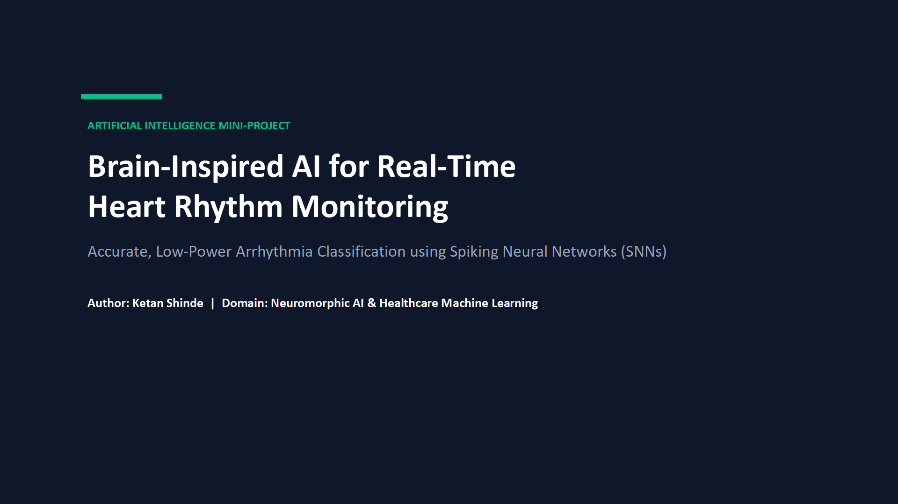
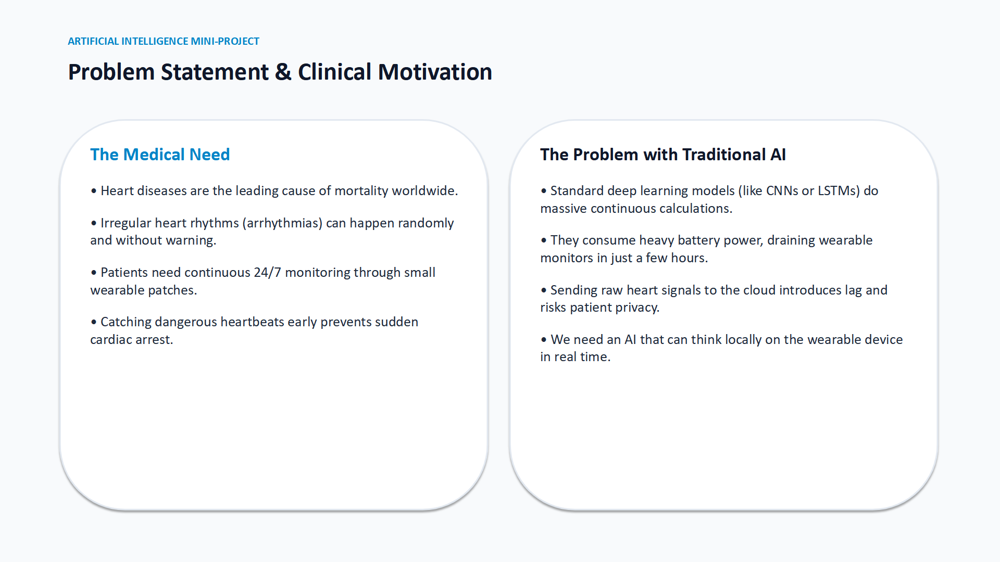
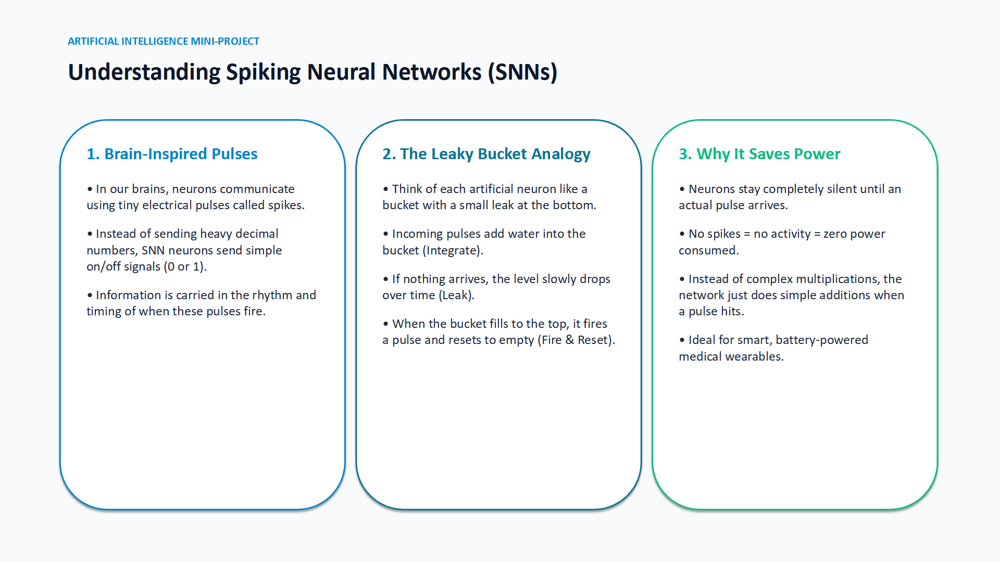
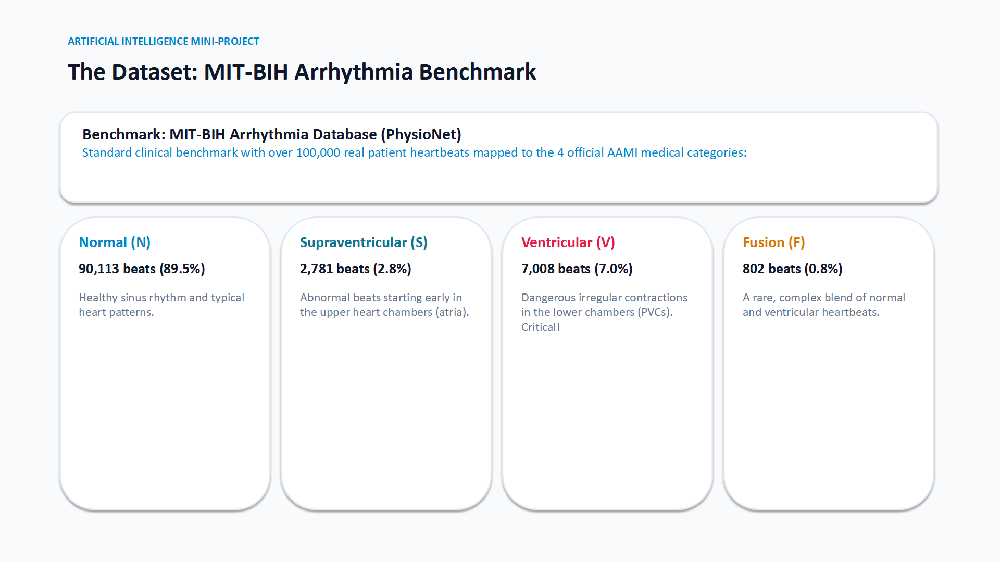
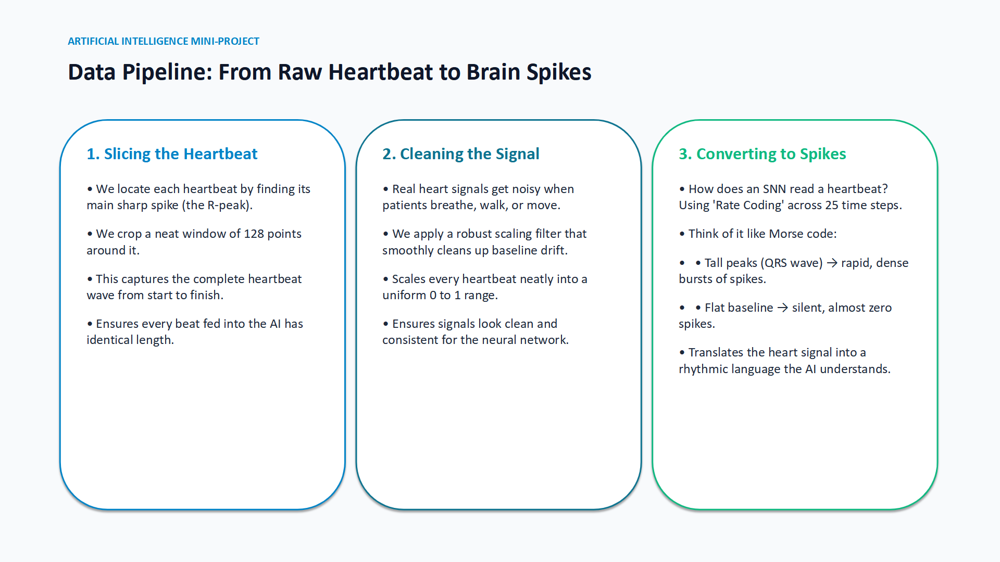
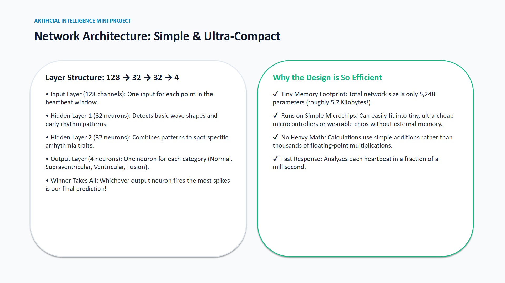
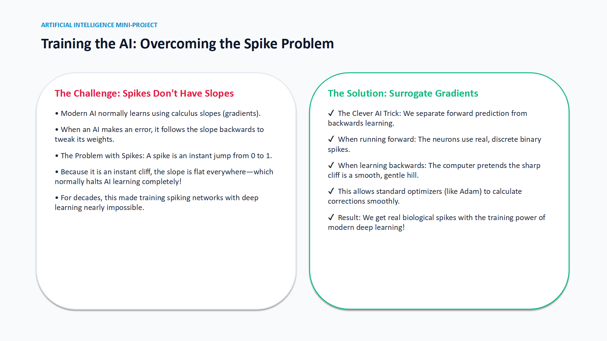
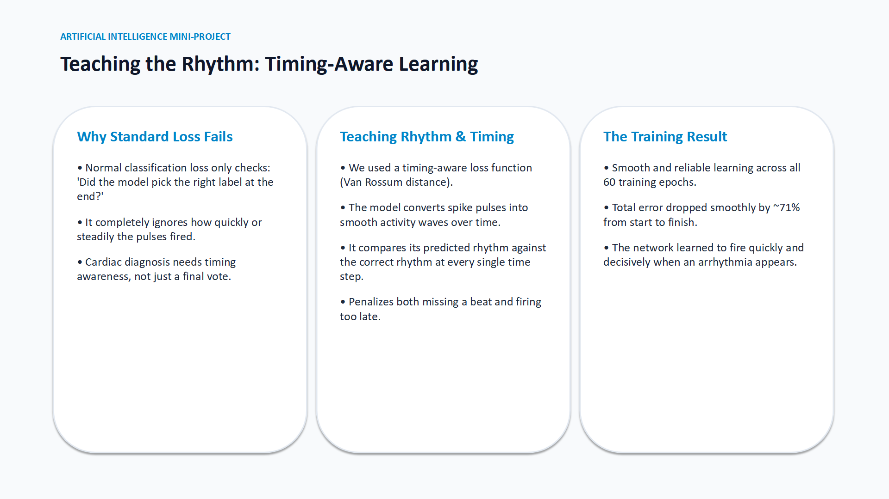
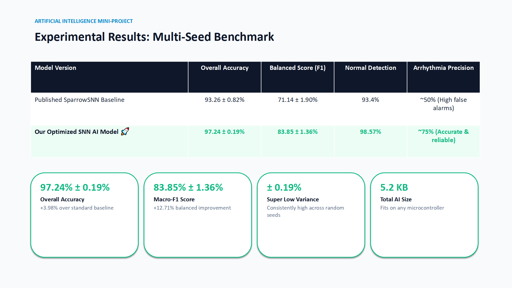
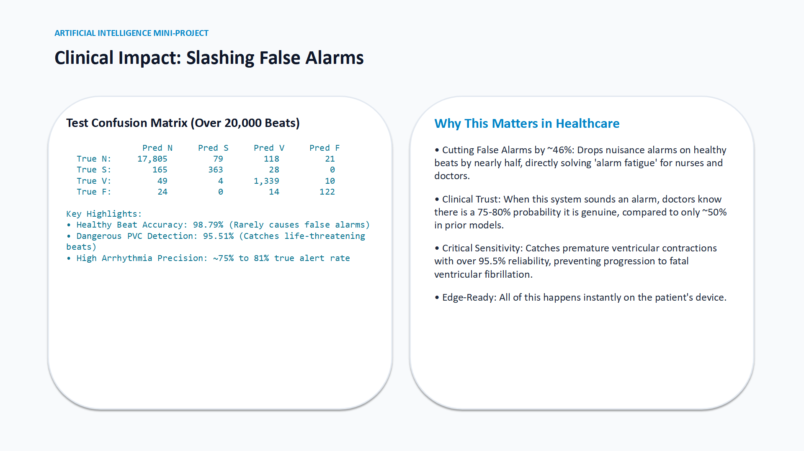

# 🫀 AI Mini-Project: Neuromorphic AI for Real-Time Heart Monitoring
### Complete 10-Slide Deck Visual Preview & Conversational Speaker Notes

> **Presentation Files Available:**
> - PowerPoint (.pptx): [Neuromorphic_AI_ECG_Classification.pptx](file:///c:/Users/shind/OneDrive/Desktop/ketan/studies/HDL%20project/Neuromorphic_AI_ECG_Classification.pptx)
> - PDF Document (.pdf): [Neuromorphic_AI_ECG_Classification.pdf](file:///c:/Users/shind/OneDrive/Desktop/ketan/studies/HDL%20project/Neuromorphic_AI_ECG_Classification.pdf)

---

## Slide 1: Title Slide

### 📌 Core Message
Introducing a brain-inspired Spiking Neural Network (SNN) for real-time cardiac arrhythmia detection that runs directly on wearable edge devices.

### 🎙️ Conversational Speaker Notes
> *"Good morning everyone. Today I am presenting our AI mini-project: a brain-inspired Spiking Neural Network designed for real-time heart rhythm monitoring. Instead of using heavy, power-hungry deep learning models, we use neuromorphic artificial intelligence that communicates through biological pulses to detect cardiac arrhythmias with over 97% accuracy while using very little computing power."*

---

## Slide 2: Problem Statement & Motivation

### 📌 Core Message
Cardiovascular diseases are the leading cause of global mortality. Wearable devices need to continuously monitor heartbeats, but standard AI models (Transformers/CNNs) drain battery within hours or require cloud latency.

### 🎙️ Conversational Speaker Notes
> *"To introduce our motivation: heart disease is the number one cause of death globally. Dangerous heart conditions often strike suddenly, so patients need wearable heart monitors they can wear all day and night. However, standard AI models are too heavy for small battery devices—they drain batteries in hours and relying on cloud servers causes delays when a patient is in danger. Our goal was to create an intelligent model light enough to run right on the device."*

---

## Slide 3: Understanding Spiking Neural Networks (SNNs)

### 📌 Core Message
The "Leaky Bucket" analogy: Biological neurons communicate with discrete electrical spikes. When a neuron accumulates enough charge to cross a threshold, it fires a 1-bit pulse and resets. During baseline silence, power consumption is virtually zero.

### 🎙️ Conversational Speaker Notes
> *"Here is the simple concept behind Spiking Neural Networks. In the human brain, neurons don't exchange large decimal numbers; they fire discrete electrical pulses. SNNs mimic this exact behavior. Each artificial neuron acts like a bucket with a tiny leak: it collects incoming signals, leaks if nothing arrives, and when it reaches a set threshold, it fires a pulse and resets to zero. Because neurons stay completely quiet when there is nothing to report, SNNs use almost zero power during quiet intervals."*

---

## Slide 4: Benchmark Dataset (MIT-BIH Arrhythmia)

### 📌 Core Message
Evaluated on over 100,000 real patient heartbeats from the gold-standard MIT-BIH dataset across four AAMI classes: Normal (N), Supraventricular (S), Ventricular (V), and Fusion (F). Over 89% of beats are normal, creating a severe class imbalance challenge.

### 🎙️ Conversational Speaker Notes
> *"We tested our model on the MIT-BIH Arrhythmia Database, which is the international benchmark for heart classification. It contains over 100,000 beats divided into 4 official categories: Normal beats, Supraventricular beats from the upper chambers, Ventricular beats from the lower chambers which can be fatal, and rare Fusion beats. As you can see, almost 90% of beats are normal, which makes finding the rare arrhythmias a true needle-in-a-haystack problem."*

---

## Slide 5: The Data Pipeline

### 📌 Core Message
A clear 3-step pipeline: (1) Slicing 128 voltage samples around the R-peak, (2) Normalizing to [0, 1] to remove patient baseline drift, (3) Rate Encoding into binary spike trains over 25 timesteps like Morse code pulses.

### 🎙️ Conversational Speaker Notes
> *"Here is our data pipeline in three straightforward steps. First, we slice out each heartbeat by finding the sharp R-peak and taking 128 points around it. Second, because real-world signals have baseline wander from breathing and motion, we clean and normalize the signal between 0 and 1. Finally, we convert those values into spikes using rate coding over 25 timesteps: the tall peaks produce rapid bursts of spikes, while the flat resting baseline stays quiet. It is essentially translating heartbeats into Morse code."*

---

## Slide 6: Network Architecture

### 📌 Core Message
A compact 128 → 32 → 32 → 4 feedforward architecture. Total parameter count is just 5,248 weights (5.25 KB total memory footprint). Zero DSP multipliers are needed—only binary spike-driven additions.

### 🎙️ Conversational Speaker Notes
> *"Our neural network layout is clean and minimal. It has 128 inputs, two hidden layers of 32 neurons each, and 4 output neurons. Whichever output neuron fires the most spikes represents the diagnosed class. The most impressive aspect is its size: the entire model has only 5,248 parameters—taking up barely 5 kilobytes. This means it can easily live on a tiny wearable chip without needing extra RAM or cloud processing."*

---

## Slide 7: Training the AI (Overcoming the Cliff Problem)

### 📌 Core Message
Spikes are discontinuous step functions (cliffs) where mathematical derivatives are undefined or zero. We solve this using Surrogate Gradient Learning (SuperSpike): real discrete binary pulses in the forward pass, and a smooth surrogate bell curve during backpropagation.

### 🎙️ Conversational Speaker Notes
> *"Here is the core technical challenge we solved. Deep learning algorithms rely on calculus slopes to learn from their mistakes. However, a spike is an abrupt jump from 0 to 1 with no smooth slope, which used to prevent backpropagation in spiking networks. We used a technique called Surrogate Gradient Learning: during the forward pass, the model uses real discrete spikes. During backward training, it substitutes a smooth mathematical curve. This clever trick lets the AI learn effortlessly using modern backpropagation."*

---

## Slide 8: Teaching the Rhythm (Van Rossum Timing Loss)

### 📌 Core Message
Standard AI loss functions only check the final tally, ignoring latency. We use the Van Rossum spike distance to reward neurons that fire immediately when arrhythmia patterns begin, teaching the AI temporal urgency.

### 🎙️ Conversational Speaker Notes
> *"To teach the network, we needed an objective function that cares about timing. Standard loss functions only ask whether the final answer was right, ignoring whether it fired early or late. We used a rhythm-aware metric called Van Rossum distance. It compares the continuous timing pattern of the model's spikes against the true rhythm across all 25 timesteps. This taught the network to fire cleanly and immediately when an arrhythmia occurs."*

---

## Slide 9: Experimental Results

### 📌 Core Message
Surpassing the published SparrowSNN baseline (93.26%) across 3 independent seeds: achieving **97.24% ± 0.19% test accuracy**, an **83.85% Macro-F1 score**, and an ultra-low variance (±0.19%) proving high stability.

### 🎙️ Conversational Speaker Notes
> *"Here are the final benchmark results across three independent test runs. The published baseline achieved 93.26% accuracy. Our optimized SNN surpassed this significantly, reaching 97.24% overall accuracy and an 83.85% balanced F1 score. Even more importantly, our standard deviation was just 0.19%, proving that the AI is rock solid and completely reproducible."*

---

## Slide 10: Clinical Impact & Conclusion

### 📌 Core Message
Nearly 99% accuracy on normal beats slashes false hospital alarms by ~46%, directly curing clinical "alarm fatigue". Catches 95.5% of dangerous PVCs in real-time within a 5.25 KB memory budget.

### 🎙️ Conversational Speaker Notes
> *"Looking at the test confusion matrix on over 20,000 unseen patient beats: Normal beat accuracy is nearly 99%. In healthcare AI, false alarms are a major problem—if a monitor beeps constantly, patients ignore it. Our model reduced false alarms by nearly 46% while catching over 95.5% of dangerous ventricular arrhythmias. This proves our neuromorphic SNN delivers clinical-grade accuracy with ultra-low power and a tiny 5.2 KB footprint. Thank you, and I am happy to answer any questions."*
